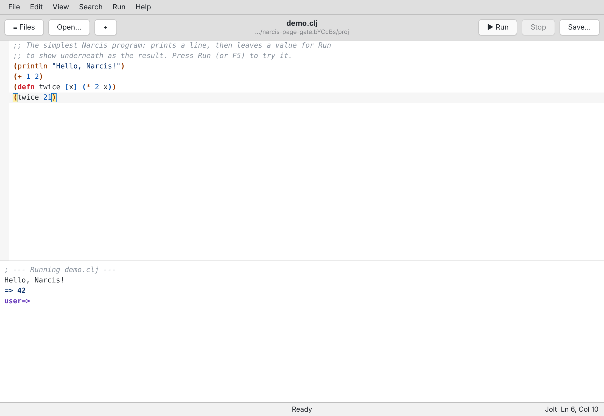
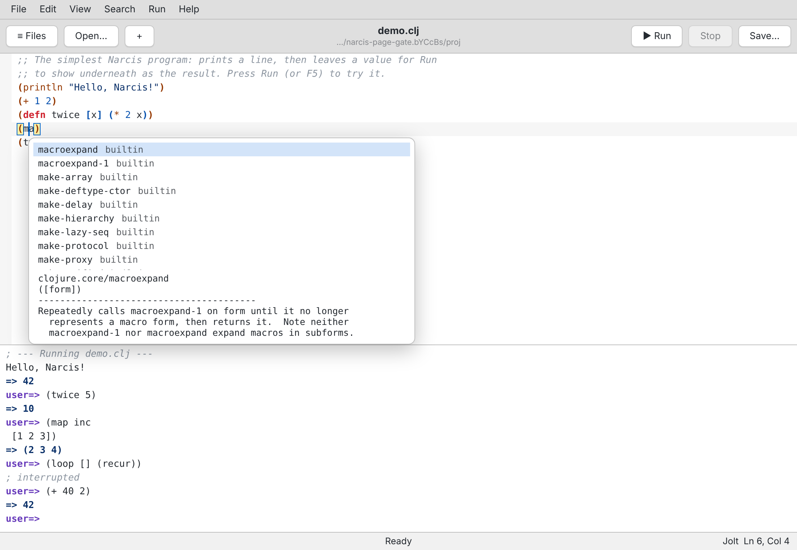
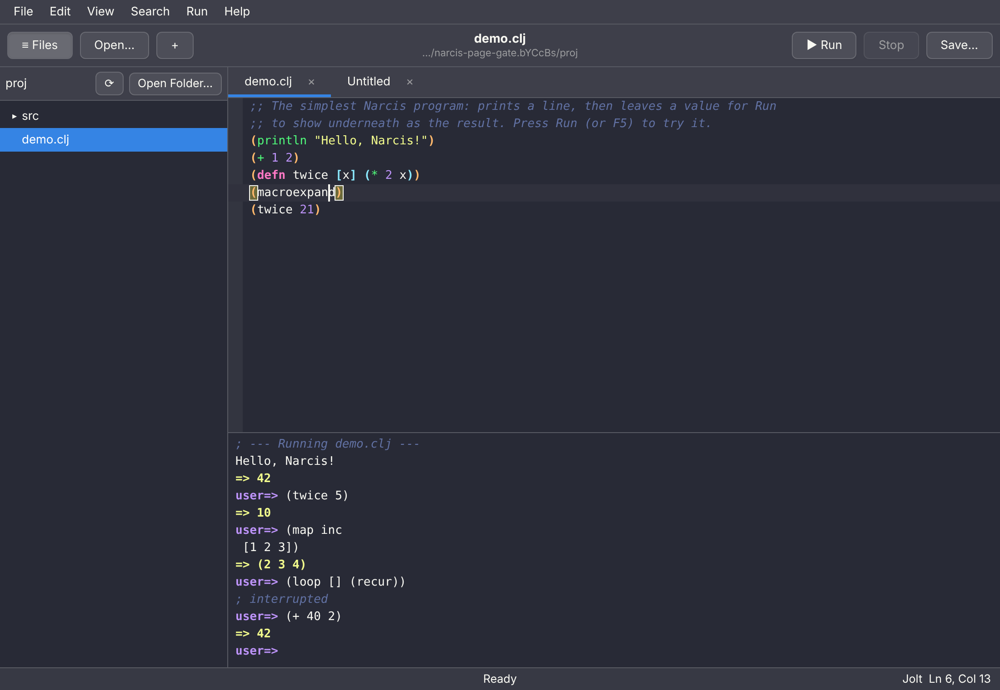

# Narcis

A DrRacket-style Clojure IDE — [Jonquil](https://github.com/b12n-oss/jonquil)
ported to Eve: a Definitions editor above an Interactions console, Run, and a
Stop that really stops, with the editor's state living in Eve disk atoms and
the window drawn in a browser page the launcher serves.



- **The buffer is an `eve.text` document** (CodeMirror 6's `Text` as Eve data:
  a B-tree of lines, indexed by character offset and by line number). It lives
  at the root of the buffer's own Eve atom. Every edit is one `swap!` that
  copies one path of the tree and shares the rest, so every earlier version is
  still there: undo is a root swap, and it works across a restart.
- **The page is a viewport.** It fetches the lines on screen, with their paint
  spans, and sends each edit back as a message. It never holds the text, so a
  file's size is not the page's problem: a 1,000,000-line file opens and edits
  at the same speed as a small one.
- **The window is Jonquil's**: its header bar (Files, Open…, +, the file's
  name, Run, Stop, Save…), its menus (Jonquil's own menu data, narrowed to the
  commands Narcis has), its file tree and tabs, its console styles and themes.
- **The language core is Jonquil's too**, lifted with its tests: the
  tokenizer and bracket analysis, the editing ops, structural editing
  (slurp, barf, raise, splice, wrap, kill, moves by form), the formatter,
  completion and documentation lookup, the console's decisions, and the
  evaluator behind Run and Stop. `UPSTREAM.md` says what came from where.




## Running it

Narcis runs on [Jolt](https://github.com/jolt-lang/jolt) (v0.8.23 or later)
over Eve's own Jolt classpath. You need a checkout of Eve 0.9.3.2
(`SeniorCareMarket/eve`, tag `v0.9.3.2`) and `bb` on your `PATH`
(Eve's classpath task runs on it).

```bash
git clone https://github.com/johnmn3/narcis.git ~/narcis-app
```

```bash
cd ~/narcis-app && EVE_RELEASE=<eve-checkout> TMPDIR=/tmp bash scripts/jolt-run.sh narcis.launcher --dir ~/narcis-app/data --port 8377 --file <path-to-a-clj-file>
```

The launcher opens `http://127.0.0.1:8377/` in your browser (open it yourself
if it does not). `--project <dir>` names the folder the file tree shows; it
defaults to the file's folder. `--theme <name>` sets the theme on first start.
The page's script (`web/app.js`) is committed prebuilt;
`scripts/build-web.sh` rebuilds it from `web/narcis/web.cljs` (it needs the
`clojure` CLI).

A store made by an earlier Narcis (its buffers were `narcis.rope` trees) is
not read: this layout's store has its own name inside `--dir`, and the old
files are left as they are.

One honest note on the store: the buffer domain is opened with Eve's
journal off. Every commit is still forced to disk, but an editor commits on
every keystroke, and at the current Eve pin the journaled path measured
600 keystrokes in 73 s against 5.5 s without it. `narcis.store-eve`'s
`domain-opts` are the opener's to change.

## Using it

| | |
|---|---|
| Run the Definitions | **▶ Run**, F5 or Ctrl/Cmd+R |
| Stop a running program | **Stop**, or Esc |
| Run the form at the caret / the selection or line | Ctrl/Cmd+Enter / Ctrl/Cmd+E |
| The console's prompt | type, Enter; Shift+Enter or an open bracket continues the input; ↑ ↓ recall |
| Switch between editor and console | F6 |
| Complete the word, with its doc beside | Ctrl+Space |
| Docs for the symbol | Ctrl+Q or Shift+F1 |
| Structural editing | Edit ▸ Structure shows every command with its chord: Ctrl+Alt+. / Ctrl+Alt+, slurp and barf, Ctrl+Alt+→ / ← move by form, Alt+Shift+→ / ← grow and shrink the selection, Ctrl+Alt+Shift+P / S / C wrap in ( ) [ ] { } |
| Format the buffer / the selection | Ctrl/Cmd+Shift+F / Ctrl/Cmd+Alt+F |
| Find | Ctrl/Cmd+F, then Enter / Shift+Enter, Ctrl/Cmd+G |
| Rename the symbol | F2 |
| File tree | **≡ Files** or Ctrl/Cmd+Shift+E |
| Every command by name | Ctrl/Cmd+Shift+P |
| Themes | View ▸ Theme (Auto follows the system) |

Run resets before it evaluates (DrRacket's rule): the namespaces your
program created are removed and the Definitions are evaluated into a fresh
`user`, while libraries stay. The console's transcript is kept in an Eve
atom beside the editor's, so it survives a restart too.

## What is not in it

Jonquil is a large program. Not ported: Parinfer, find-and-replace, jump to
definition and the Locations list, the inspector, the debugger (breakpoints,
Break on error, stepping), tracing and line counts, Run Tests, the dialects
other than Jolt (JVM Clojure, ClojureScript, ClojureDart, jank, nREPL
attach), out-of-process Jolt, plugins, the MCP server, the terminal, change
sets and Compare, Save World, preferences and editable key bindings, and
the guide pages. The menus show only what is there.

Narcis is also Jolt-only for now: the evaluator interrupts a running
program through Jolt's interrupt token, so the app does not yet run on the
JVM.

## How it is put together

- `src/eve/text.cljc` — the buffer's document: Eve's `eve.text` library,
  carried unchanged (provenance and hashes in `UPSTREAM.md`).
- `src/narcis/buffer.cljc` — a buffer is a `BufferState` at the root of its
  own Eve atom; every mutation is one `swap!` with the text op inside it.
- `src/narcis/` (syntax, edit, structural, commands, eval, console, docs,
  theme, paint, menus) — Jonquil's language core, lifted; `UPSTREAM.md` has
  the file-by-file table.
- `src/narcis/launcher.clj` — the server: it holds the store, answers the
  page's window/edit/run messages, and serves the page.
- `web/narcis/web.cljs` — the page: a viewport over the server's windows,
  never a copy of the text.

## Tests

Each needs `EVE_RELEASE` as above; all run on Jolt.

```bash
bash scripts/jolt-run.sh narcis.run-all-tests
```

```bash
bash scripts/buffer-gate.sh jolt
```

```bash
bash scripts/editor-gate.sh
```

```bash
bash scripts/page-gate.sh
```

`run-all-tests` is the lifted Jonquil corpus and Narcis's own tests;
`buffer-gate` walks undo and redo across a restart; `editor-gate` is an
editing session over HTTP with a `kill -9` in the middle; `page-gate` drives
the real page in headless Chromium (it needs `node` with `playwright`).

Latest results at the current tip (2026-11-17, Jolt v0.8.23, Eve
`84bfc7c8`): 153 tests, 1,333 assertions, 0 failures across the corpus;
buffer and store gates pass; the editor gate passes 27/27; the page gate
passes 44/44; the viewport gate passes 3/3 with a 1,000,000-line file
opening inside a 60 s run. Over HTTP at 4,000 lines, a keystroke with its
repaint measures 33 ms and a 100-line window fetch 26 ms.

## License and attribution

Narcis is distributed under the Eclipse Public License 2.0 — see
`LICENSE`, which is Jonquil's license text unchanged. `NOTICE` carries the
credits: Jonquil and the DrClojure lineage behind the lifted code, the
editor themes whose published colours the palettes use, eve.text and its
CodeMirror 6 design source, and the Eve and Jolt runtimes Narcis stands
on. `UPSTREAM.md` is the provenance record: every lifted file, its
upstream, its pin, and what changed.
